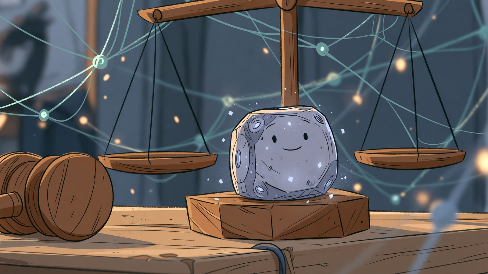

import Termin from '../../../components/Termin.astro';
import SlowniczekStrony from '../../../components/SlowniczekStrony.astro';

:::note[O tej stronie]
Około 8 minut czytania i 5 minut ćwiczenia, najlepiej po sekcji [AI w praktyce](/praktyka/).
:::

## Kto odpowiada, gdy AI podejmie złą decyzję?

Odpowiada ten, kto podpisuje decyzję, bo **etykieta "policzyła maszyna" nie zdejmuje odpowiedzialności**. Jeśli nie wiesz, kto podpisuje, nie oddawaj decyzji maszynie. Weź jedną decyzję ze swojego otoczenia i nadaj jej trzy etykiety: kto jest poszkodowany przy pomyłce, kto odpowiada i czy człowiek może ją cofnąć.

## Trzy problemy etyczne

Prywatność danych ma własną lekcję: [Prywatność i dane](/etyka/prywatnosc/). Tu nie powtarzam listy "czego nie wklejać".

### 1. Dane niosą uprzedzenie

<Termin id="model">Model</Termin> nie ma moralności, ma statystykę z tekstów i historii decyzji. Jeśli w rekrutacji historycznie awansowała jedna grupa, system, który wstępnie odsiewa kandydatów, umie to wzmocnić i nazwać "dopasowaniem".

Ten problem jest starszy niż chatboty. [Analiza ProPublica z 2016](https://www.propublica.org/article/machine-bias-risk-assessments-in-criminal-sentencing) o COMPAS i rekrutacja Amazona z 2018 wracają już w [ograniczeniach](/podstawy/ograniczenia/) i [mitach](/podstawy/mity-vs-rzeczywistosc/). Tu zostaje reguła: **przy decyzji o osobie model podsuwa, człowiek zatrudnia, kredytuje, ocenia**.

### 2. Czarna skrzynka przy stawce

Model AI rzadko potrafi wiarygodnie pokazać, dlaczego doszedł do wniosku. Nawet gdy poda uzasadnienie, nie wiadomo, czy to faktyczny powód. Przy memie to nieważne. Przy odmowie kredytu, odrzuceniu CV albo sugestii klinicznej brak toku rozumowania jest problemem etycznym, bo od "tak wyszło" nie da się odwołać.

Technik wyjaśniania decyzji AI tu nie omawiam. Wystarczy Ci pytanie: **czy ktoś potrafi wyjaśnić tę decyzję osobie, której dotyczy?** Jeśli nie, system nie powinien być jedynym sędzią.

### 3. Autonomia bez hamulca

"Człowiek w pętli" znaczy: krytyczny krok wymaga zatwierdzenia, a zatwierdzenie da się cofnąć. Co jest krytyczne, a co rutynowe, wyznacza koszt pomyłki: im droższy błąd w danej [branży](/praktyka/ai-w-branzach/), tym więcej kroków wymaga zatwierdzenia przez człowieka.

Autonomiczny samochód i broń to skrajne przykłady z nagłówków. Na tej stronie bliższy jest <Termin id="chatbot">chatbot</Termin>, który odsyła kogoś z kryzysem "do siebie", albo automat odsiewający CV, od którego decyzji nie da się odwołać. Hamulec musi działać w samym procesie: ktoś zatwierdza krytyczny krok i może go cofnąć.

### Zasada uczciwości

Trzy problemy powyżej dotyczą decyzji o innych. Ta zasada dotyczy Twojego podpisu: **jeśli tekst, praca albo grafika powstały z pomocą AI, nie udajesz, że to wyłącznie Twoja praca.** Szkoła, uczelnia i pracodawca mogą mieć własne reguły - sprawdzasz je osobno.

## Przepisy: tylko tyle, że istnieją

[Rekomendacja UNESCO w sprawie etyki AI](https://www.unesco.org/en/artificial-intelligence/recommendation-ethics) z listopada 2021 r. to dokument 193 państw: kompas etyczny (nadzór człowieka, odpowiedzialność), a nie przepis.

W Unii Europejskiej obowiązuje też rozporządzenie o sztucznej inteligencji (AI Act), a inne kraje regulują AI po swojemu. Nie streszczam tu przepisów, terminów ani obowiązków firm. To samo dotyczy pytania, kto ma prawa do tekstu albo obrazu z modelu. Praktyka na dziś: trzymasz się zasady uczciwości z tej strony i nie prosisz modelu, żeby coś sprzedał, udając żyjącą osobę.

**Prawo dotyczące AI i danych zmienia się ciągle, a tę stronę aktualizuję cyklicznie, więc nie zawsze będzie z nim na bieżąco. Nie jestem prawnikiem - informacje tutaj nie są poradą prawną. Kwestie prawne najlepiej omawiać z prawnikiem - sprawdzoną osobą, którą polecam, jest [Paula Skrzypecka](https://www.linkedin.com/in/paula-skrzypecka/).**

## Czego tu nie ma

Nie rozstrzygam, czy model "ma prawa". Nie ma tu też tabeli "co wolno w którym kraju".

## Ćwiczenie: 5 minut, jeden podpis

Wystarczy **jedna** decyzja z ostatniego miesiąca albo hipotetyczna, z pracy, szkoły albo urzędu.

1. Zapisz decyzję w czterech słowach (np. "odsianie CV na staż").
2. Trzy etykiety:
    - kogo boli pomyłka
    - kto odpowiada (nazwa roli, nie "AI")
    - czy da się cofnąć (tak / nie / nie wiem)
3. Jedno zdanie: model może dać szkic / model nie wchodzi.

**Zaliczenie:** trzy etykiety na kartce. "Nie wiem, kto odpowiada" liczy się jako sygnał, żeby nie oddawać tej decyzji, a nie jako porażka.

**Typowy wynik:** szkic ogłoszenia - tak; odrzucenie kandydata albo diagnoza - nie.

**Jeśli nic nie zgrzyta i zostaje czas:** sprawdź, czy w Twoim narzędziu widać, że odpowiada AI. Osoba po drugiej stronie powinna to wiedzieć bez zgadywania.

## Teraz wiesz

- Uprzedzenie siedzi w danych. "Obiektywne, bo liczy maszyna" nic nie czyści.
- Przy stawce na osobę pytasz o podpis i o cofnięcie, nie o benchmark modelu.
- Przepisy o AI zmieniają się szybko. W konkretnej sprawie pytasz prawnika, nie nagłówek ani tę stronę.
- Zasada uczciwości: tekstu z pomocą AI nie podpisujesz jako wyłącznie swojego.

**Następny krok:** [Prywatność i dane](/etyka/prywatnosc/) - co wolno wkleić, co zanonimizować, a czego nie wklejasz wcale.

<SlowniczekStrony terminy={["model", "chatbot"]} />
