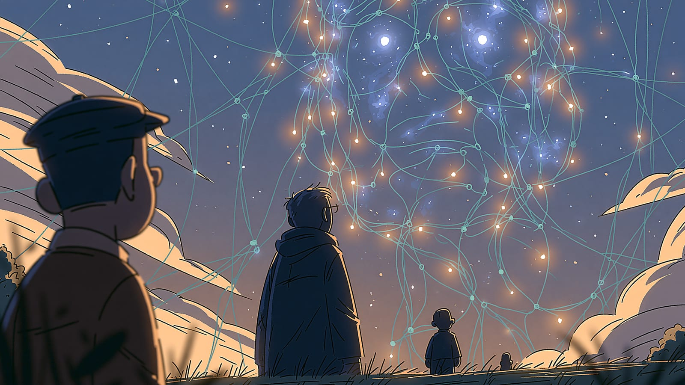

import Termin from '../../../components/Termin.astro';
import SlowniczekStrony from '../../../components/SlowniczekStrony.astro';



:::note[O tej stronie]
Około 6 minut czytania i 5 minut ćwiczenia, najlepiej po lekcji [Jak uczą się modele](/jak-dziala-ai/jak-ucza-sie-modele/).
:::

## Czy AI, z której dziś korzystam, to już inteligencja jak z filmów?

Nie. **Wszystko, z czego dziś korzystasz, to wąska AI.** Ogólna inteligencja (AGI) i superinteligencja (ASI) nie istnieją. Weźmiesz jedno zdanie z newsa albo z reklamy i ocenisz: wąska AI, AGI, ASI, a może marketing miesza poziomy. Podziału na obraz, dźwięk i tekst tu nie ma, bo to katalog narzędzi.

## Film pokazuje umysł. Produkt pokazuje zadanie

Na hasło "sztuczna inteligencja" łatwo wyobrazić sobie robota z kina: świadomy, uczy się wszystkiego, ma plan. W sklepie i w przeglądarce znajdziesz system do _tego_ zadania albo do wiązki zadań językowych, które i tak siedzą w jednym modelu.

Dlatego nagłówek "AI dorównała człowiekowi" nic nie mówi, dopóki nie wiesz: **w czym?** W teście, w grze, w transkrypcji - to nadal wąska liga. We wszystkim, jak osoba - tego produktu nie ma.

Podział z [Czym jest AI?](/podstawy/czym-jest-ai/) (AI vs generatywna) dotyczy tego, _co_ program robi. Ten dotyczy tego, _jak szeroko_. <Termin id="genai">Generatywna AI</Termin> też jest wąska.

W [Czym jest AI?](/podstawy/czym-jest-ai/) padło: dziś istnieje tylko wąska AI, a ogólnej nie ma. Tu dokładasz trzeci poziom - superinteligencję - i ćwiczysz rozpoznawanie poziomu na nagłówkach.

## Trzy poziomy. Na dole stoimy, góra jest pusta

News lubi skróty: ANI (wąska, Artificial Narrow Intelligence), AGI (ogólna, Artificial General Intelligence), ASI (Artificial Superintelligence). Niżej każdy z nich po polsku.

### Wąska AI (ANI) - jedyny typ, który masz

Zaprojektowana do jednego zadania albo wąskiego zestawu. Może być mistrzem w swojej dziedzinie i zero poza nią. Klasycznie: program do gry w go (azjatycką grę planszową) nie napisze maila.

<Termin id="chatbot">Chatbot</Termin> łatwo pomylić z czymś więcej, bo w jednym oknie robi wiele rzeczy z języka. To nadal wąska AI: nie rozumie świata jak człowiek, nie ma świadomości ani własnych celów, między treningami nie "żyje i się uczy". Dlaczego model nie rozumie tego, co pisze, wyjaśniam w [Ograniczeniach](/podstawy/ograniczenia/).

### Ogólna AI (AGI) - cel, nie produkt

Hipotetyczny system na miarę człowieka _we wszystkich_ dziedzinach, z cechami, które znasz z [Czym jest AI?](/podstawy/czym-jest-ai/): przenoszeniem umiejętności, uczeniem się w trakcie działania i spójnym obrazem świata.

Status: nie istnieje. Daty tu nie zgaduję, bo spekulacje "za trzy lata / nigdy" starzeją się szybciej niż ta lekcja. AGI nie otworzysz w przeglądarce.

### Superinteligencja (ASI) - poziom nad pustym

Hipotetyczny system _ponad_ ludzką inteligencją w nauce, twórczości, strategii. Pisze się o niej w filozofii i fantastyce. W sklepie nie ma czego włączać.

| Pytanie | Wąska | AGI | ASI |
| --- | --- | --- | --- |
| Istnieje? | Tak | Nie | Nie |
| Zakres | Zadanie albo wąska wiązka | Wszystkie ludzkie | Ponad ludzkie |
| Przykład, który klikniesz | Chatbot, filtr, nawigacja | Brak | Brak |

Patrz przede wszystkim na pierwszą kolumnę - tylko w niej stoi "tak". Dwie pozostałe opisują systemy z publikacji i debat, a nie z paska adresu.

## Ćwiczenie: 5 minut, trzy nagłówki

Najpierw własna etykieta, potem możesz spytać czat. Etykiety: **wąska**, **AGI (nie istnieje)**, **ASI (nie istnieje)**, **marketing miesza**.

1. "Nowy asystent napisał wiersz i poprawił kod w jednym oknie."
2. "AI dorównała człowiekowi we wszystkich zawodach."
3. "System pokonał mistrza świata w Go."

Potem porównaj: 1 wąska (wiele zadań językowych to nie AGI), 2 marketing albo AGI, którego nie ma, 3 wąska - mistrzostwo w jednej grze.

**Zaliczenie:** trzy etykiety na kartce. 2/3 zalicza.

**Gdzie łatwo się pomylić:** punkt 1 łatwo oznaczyć jako AGI, bo "umie więcej niż jedną rzecz". Wiele zadań językowych w jednym oknie to nadal wąska AI.

**Jeśli nic nie zgrzyta i zostaje czas:** wklej prawdziwy nagłówek z dzisiaj.

```text
Oceń zdanie: "[wklej nagłówek]". Jedna etykieta: wąska AI, AGI (nie istnieje), ASI (nie istnieje), marketing miesza poziomy. Jedno zdanie: jakie zadanie jest w zdaniu, a jakiego brakuje. Nie zgaduj daty powstania AGI.
```

Zostaw swoją etykietę obok odpowiedzi modelu. Przy braku zakresu zadania model też bywa pewny - to nie zmienia faktu, że AGI nie ma.

## Teraz wiesz

- Cała dzisiejsza AI, w tym chatboty, to wąska AI.
- AGI i ASI nie istnieją. Nagłówek bez nazwy zadania nie zasługuje na słowo "ogólna".
- Wąska nie znaczy słaba. Znaczy "w tym, nie we wszystkim".

**Następny krok:** [Modele językowe LLM](/jak-dziala-ai/modele-jezykowe/) - co siedzi pod czatem: przewidywanie kolejnego kawałka tekstu, nie "umysł".

<SlowniczekStrony terminy={["genai", "chatbot"]} />
