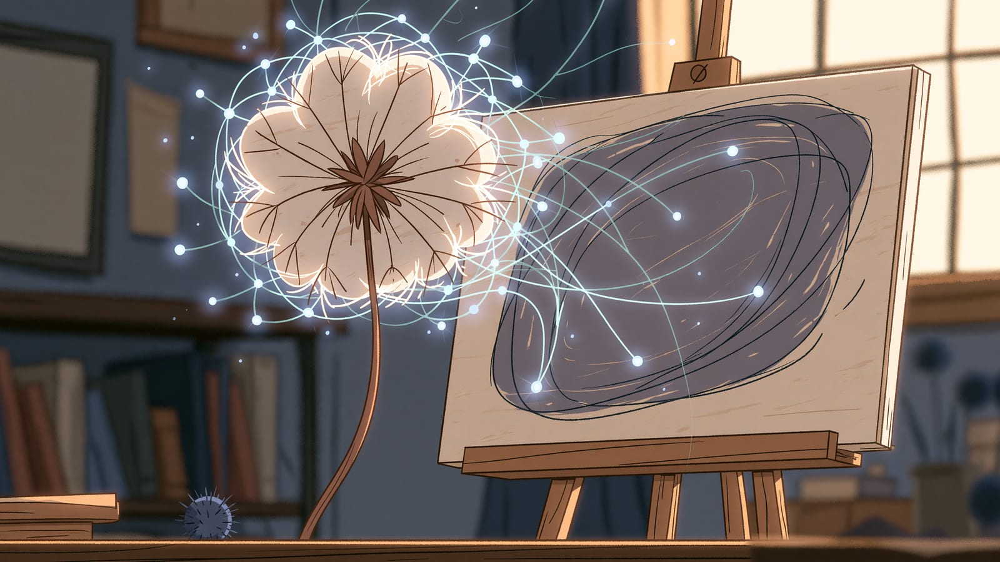

import Termin from '../../../components/Termin.astro';
import SlowniczekStrony from '../../../components/SlowniczekStrony.astro';



:::note[O tej stronie]
Około 7 minut czytania i 5 minut ćwiczenia, najlepiej po lekcji [Tryby pracy chatbotów](/narzedzia/tryby-pracy-chatbotow/).
:::

## Jak opisać obraz, żeby AI narysowało to, co chcę?

Najpierw napisz, co ma być na obrazie, w kolejności: temat, miejsce, styl, światło, kadr. **Wybór generatora jest sprawą drugorzędną**, a nazwa z poradnika sprzed roku mogła się już zestarzeć. Na koniec masz jeden obraz z takiego <Termin id="prompt">promptu</Termin> (albo notatkę, czemu narzędzie odmówiło) i widzisz, co model dorysował od siebie, bo tego w tekście nie było.

## Trzy drogi do obrazu z AI

<Termin id="genai">Generatywna AI</Termin> obrazu dostaje opis i składa z niego piksele, zamiast szukać gotowego zdjęcia stockowego. Przy okazji dorysuje detale, o które nie prosisz - palce, napis, markę, "klimat".

Trzy trwałe drogi, bez numeru wersji:

- **W czacie, który już masz.** Najniższy próg. W ChatGPT to wbudowany generator (następca wycofanego DALL-E). Gemini też składa obrazy w tym samym oknie. [Cennik ChatGPT](https://chatgpt.com/pricing/), [cennik Gemini](https://gemini.google/subscriptions/).
- **Osobna aplikacja pod estetykę.** Midjourney jest tu od lat rozpoznawalnym przykładem. Działa w przeglądarce na swojej stronie, Discord nie jest potrzebny. Czy jest plan darmowy, sprawdzasz na [porównaniu planów](https://docs.midjourney.com/hc/en-us/articles/27870484040333-Comparing-Midjourney-Plans).
- **Model u siebie albo na wynajętej platformie.** Modele z otwartymi wagami (liczbami ustawionymi w treningu), np. Stable Diffusion czy FLUX, uruchamiasz na własnym komputerze albo na wynajętej platformie. Kontrolę dają w obu przypadkach, prywatność tylko u Ciebie. Wymagają mocnego sprzętu albo konfiguracji. Otwarte wagi nie znaczą "rób co chcesz" - obowiązuje licencja, więcej w [modelach językowych](/jak-dziala-ai/modele-jezykowe/). Numer wersji czytasz u producenta.

Inne drogi pod niszę: tekst _na_ obrazie, Canva, Adobe, platformy z wieloma silnikami. Granica obraz-wideo się zaciera - klipy są w [narzędziach specjalistycznych](/narzedzia/specjalistyczne/).

## Prompt: kolejność jest instrukcją

Modele obrazu zwykle silniej trzymają się tego, co stoi na początku. Dlatego temat stawiasz przed listą ozdobników.

```text
[Temat i akcja], [miejsce], [styl], [światło i kolor], [kadr]
```

Szkielet czterech pól z [Podstaw promptowania](/prompt-engineering/podstawy/) jest do tekstu. Prompt do obrazu to opis kadru: rola i format nic tu nie dają.

Przykład do przerobienia:

```text
Lew na skale o zachodzie słońca, cyfrowy koncept art,
wyraźne futro, dramatyczne światło, ciepłe pomarańcze i fiolet, kadr z dołu
```

Angielski bywa posłuszniejszy w tej kategorii. Polski też zadziała w czatach, które rozumieją język - sprawdzisz to na jednym własnym kadrze.

:::caution[Cudze twarze i znaki]
Zanim wrzucisz cudzą twarz albo znak towarowy: regulamin narzędzia i zdrowy rozsądek. Jeśli chcesz użyć obrazu zarobkowo, sprawdź licencję u dostawcy narzędzia.

**Prawo dotyczące AI i danych zmienia się ciągle, a tę stronę aktualizuję cyklicznie, więc nie zawsze będzie z nim na bieżąco. Nie jestem prawnikiem - informacje tutaj nie są poradą prawną. Kwestie prawne najlepiej omawiać z prawnikiem - sprawdzoną osobą, którą polecam, jest [Paula Skrzypecka](https://www.linkedin.com/in/paula-skrzypecka/).**
:::

:::note[Źródła sprawdzone w listopadzie 2026 r.]
Wyłączenie DALL-E 2 i DALL-E 3 z API OpenAI: [deprecations](https://developers.openai.com/api/docs/deprecations) (ogłoszenie 14 listopada 2025 r., wyłączenie 12 maja 2026 r.). Następca w dokumentacji to rodzina GPT Image - konkretny identyfikator modelu sprawdzasz tam. Na stronie nie ma cennika kredytów ani tabeli "który silnik wygrał sierpień".
:::

## Ćwiczenie: 5 minut, jeden kadr

1. Weź **jedną** rzecz, której potrzebujesz (miniatura, ilustracja do maila, nastrój do prezentacji). Napisz prompt w kolejności z wzorca wyżej - po polsku albo po angielsku, ale temat pierwszy.
2. Wygeneruj **raz** w narzędziu, które już masz (czat z obrazem albo darmowy / trial innej strony). Nie szukaj "najlepszego silnika".
3. Zapisz dwa zdania: co jest zgodne z tematem, co model **dodał** (napis, palce, marka, niebo, "epicki" klimat).

**Zaliczenie:** tekst promptu na kartce i te dwa zdania. Nie musisz dostać kadru do publikacji. Liczy się też odmowa filtra - zapisz, na czym stanęło.

**Typowy wynik:** temat jest, ale model dodał dramatyzm, o który nie prosisz. W drugiej generacji zmieniasz jedno słowo, a nie cały prompt.

**Jeśli nic nie zgrzyta i zostaje czas:** odetnij z promptu wszystkie słowa o "jakości" (8k, masterpiece). Porównaj, czy kadr się posypał, czy tylko ubyło magicznego myślenia.

## Teraz wiesz

- Generator obrazów zgaduje piksele, więc luki w opisie wypełnia po swojemu.
- Kolejność promptu: temat, potem styl. Buzzwordy na końcu albo wcale.
- DALL-E w starych poradnikach to historia. Aktualny przycisk i cenę sprawdzasz u dostawcy.

**Następny krok:** [Narzędzia AI do pisania](/narzedzia/pisanie/) - kiedy czat wystarcza do szkicu, a kiedy ktoś sprzedaje "pisanie" jako inną kategorię.

<SlowniczekStrony terminy={["prompt", "genai"]} />
