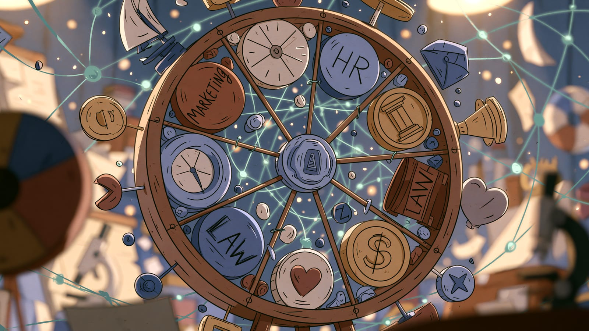

import Termin from '../../../components/Termin.astro';
import SlowniczekStrony from '../../../components/SlowniczekStrony.astro';

:::note[O tej stronie]
**Czas:** ok. 8 minut czytania + 5 minut ćwiczenia.
**Poziom:** średni, start sekcji [AI w praktyce](/praktyka/), po sekcji [Suwerenne AI](/suwerenne-ai/).
**Wcześniej:** [AI na własnym komputerze](/suwerenne-ai/ai-na-wlasnym-komputerze/) - wiesz, kiedy zadanie może iść do chmury, a kiedy zostaje na Twoim komputerze. **Teraz:** wybierasz zadania w swojej branży, zamiast slajdu "AI wszędzie".
:::

## Na tej stronie wybierzesz trzy zadania, nie branżowy cennik

Po tej lekcji wskażesz dwa zadania, w których AI może dać szkic, i jedno, które zostaje przy człowieku - z powodem w jednym zdaniu. Nie uczysz się tu listy marek oprogramowania.

Jedna rzecz do zapamiętania: **mierzysz zadanie (tekst, dokument, decyzja), nie "dojrzałość branży" z tabelki bez źródła.**

## Branża nie jest magią. Mechanizm się powtarza

To, co AI robi w pracy, zależy od branży. W marketingu produktem bywa tekst. W księgowości - powtarzalny dokument. W prawie i zdrowiu cena pomyłki jest inna, więc kontrola człowieka jest ściślejsza.

Jeśli Twojej branży nie ma poniżej, weź najbliższą. Pytanie jest to samo: co w tygodniu jest powtarzalne i tanie w błędzie, a co jest wyrokiem na człowieka albo na pacjenta.

Raport McKinsey [The State of AI 2025](https://www.mckinsey.com/~/media/mckinsey/business%20functions/quantumblack/our%20insights/the%20state%20of%20ai/november%202025/the-state-of-ai-in-2025.pdf) podsumowuje osiem lat badania: IT oraz marketing i sprzedaż to działy, w których respondenci najczęściej mówią o używaniu AI. Wzrost przychodów z AI respondenci najczęściej zgłaszają właśnie w marketingu i sprzedaży, strategii i finansach korporacyjnych oraz w rozwoju produktu. To obraz **adopcji i deklaracji**, nie Twojego zwrotu z inwestycji (ROI).

:::caution[Tak nie]
"W marketingu firmy oszczędzają 40-60% czasu i robią kampanie 2-3 razy szybciej, więc u nas będzie tak samo."
:::

:::tip[Tak]
"Jedno zadanie. Czas przed i po, łącznie z poprawkami. Jeśli po weryfikacji nie zostaje zysk - to nie jest oszczędność."
:::

:::note[Źródła sprawdzone w listopadzie 2026 r.]
Na tej stronie nie ma procentów oszczędności czasu - nie znalazłem badania, które by je potwierdzało. Raport McKinsey z listopada 2025 r. to ankieta wśród firm o tym, gdzie używają AI, nie pomiar zaoszczędzonych godzin.
:::

## Sześć mechanizmów, nie sześć cudów

**Marketing i sprzedaż.** Szkic posta, warianty nagłówków, dobór słów, których ludzie szukają w Google, notatka po rozmowie. Stawka rośnie, gdy za tekstem stoi budżet reklamy. Masowa "spersonalizowana" wiadomość do osoby, która Cię nie zna, bardzo szybko przestaje brzmieć jak do kogoś.

**HR.** Szkic ogłoszenia, wstępna selekcja CV, odpowiedzi na powtarzalne pytania. Uprzedzenia w danych rekrutacyjnych wracały już w [mitach](/podstawy/mity-vs-rzeczywistosc/) (Amazon, 2018), dlatego decyzja o człowieku nie wychodzi z modelu: AI podsuwa, człowiek zatrudnia.

**Finanse i księgowość.** Kategoryzacja, sprawdzanie, czy zapisy się zgadzają, flagowanie anomalii, szkic raportu. Dużo tu tabel, reguł i ostrych przepisów. Wdrożenie trwa dłużej niż w treściach, bo ktoś musi wytłumaczyć, _dlaczego_ model tak policzył.

**Prawo.** Research, szkic umowy, wyciąg klauzul. Każdy cytat i precedens do sprawdzenia. <Termin id="model">Model</Termin> umie zmyślić orzeczenie spokojnym tonem - to <Termin id="halucynacje">halucynacja</Termin>, nie rzadki wypadek. To narzędzie, nie porada prawna.

**Zdrowie.** Administracja (notatka z wizyty, przypisywanie kodów chorób i zabiegów do dokumentacji) jest najmniej sporna. Obraz (RTG, skóra) bywa wsparciem dla osoby z uprawnieniami - odczyt zatwierdza lekarz, nie model. Projektowanie cząsteczek i przegląd literatury to osobny tor badań, nie czat przy łóżku. Etyczne ramy WHO z 2021 zostają jako dokument odniesienia, nie jako sondaż "na 2026": [Ethics and governance of AI for health](https://www.who.int/publications/i/item/9789240029200).

**Edukacja.** Szkic ćwiczeń, informacja zwrotna o tekście, quiz. AI ma wspierać naukę, nie pisać pracy za ucznia. Zakaz bez nauki krytycznego użycia zwykle przegrywa z rzeczywistością telefonu.

W innych dziedzinach działa to tak samo: w nieruchomościach AI szkicuje opisy ofert, w sklepie podpowiada produkty, w fabryce pomaga przewidywać awarie maszyn, a w studiu graficznym szkicuje pierwsze projekty.

Tabeli "dojrzałość wysoka / niska" tu nie wstawiam, bo byłaby oceną bez metody. Mogę podać tylko ogólny kierunek: treści i praca biurowa na dokumentach wchodzą szybciej; zdrowie, prawo i szkoła wolniej, bo stawka i przepisy.

## Jedna kolejność, niezależnie od sektora

1. Wskaż wąskie gardło - powtarzalne, mierzalne, tanie w błędzie.
2. Jedno narzędzie, jeden proces. Zmierz. Popraw.
3. Ustal, kto sprawdza wynik i w którym momencie można zatrzymać proces - szkolenie i informacja zwrotna, nie "zastępstwo działu".
4. Patrz na jakość wyjścia i satysfakcję, nie tylko na "ile znaków model wypluł".

## Ćwiczenie: 5 minut, dwa szkice i jeden zakaz

Nie robisz strategii transformacji. Wybierasz **trzy** zadania z własnej branży (albo najbliższej z listy wyżej).

1. Zapisz branżę jednym słowem.
2. Dwa zadania: "AI może dać szkic, ja poprawiam."
3. Jedno zadanie: "zostaje przy człowieku" + powód w jednym zdaniu (np. "wyrok na kandydata", "diagnoza", "wysłanie oferty z ceną").

**Zaliczenie:** w ciągu 5 minut masz trzy wiersze na kartce. Nie cytujesz cudzego procentu oszczędności. Nie wybierasz narzędzia z listy marek.

**Typowy wynik:** szkic ogłoszenia / szkic posta / wstępna selekcja CV - tak; zatrudnienie, diagnoza, podpis pod umową - nie.

**Jeśli nic nie zgrzyta i zostaje czas:** oszacuj czas jednego szkicu w zeszłym tygodniu (łącznie z poprawką). Jedna liczba własna bije slajd z konferencji.

## Teraz wiesz

- Najpierw zadanie i cena błędu, potem narzędzie. Branża tylko podpowiada mechanizm.
- McKinsey 2025 mówi o częstym użyciu w marketingu i sprzedaży - to adopcja, nie Twoje 40%.
- Człowiek zostaje tam, gdzie pomyłka jest nieodwracalna albo dotyczy praw drugiej osoby.

**Następny krok:** [Przykłady wdrożeń AI](/praktyka/case-studies/) - pięć scenariuszy ilustracyjnych. Ćwiczysz rozpoznawanie, kto sprawdza wynik i w którym momencie można zatrzymać proces - bez liczb oszczędności z cudzych prezentacji.

<SlowniczekStrony terminy={["model", "halucynacje"]} />
