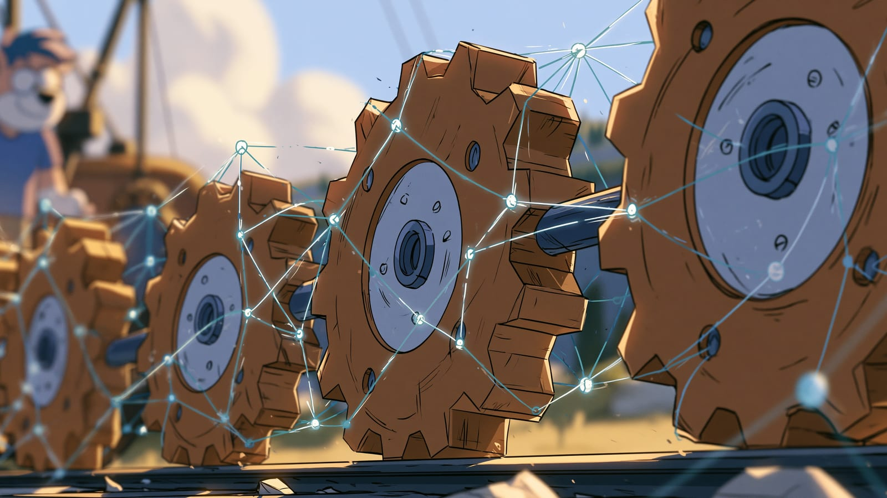

import Termin from '../../../components/Termin.astro';
import SlowniczekStrony from '../../../components/SlowniczekStrony.astro';



:::note[O tej stronie]
Około 6 minut czytania i 5 minut ćwiczenia, najlepiej po lekcji [Inżynieria kontekstu](/prompt-engineering/inzynieria-kontekstu/).
:::

## Jak połączyć dwa prompty w łańcuch?

Pierwszy <Termin id="prompt">prompt</Termin> wyciąga z notatki listę, a drugi pisze checklistę **tylko** z tej listy. Każdy prompt w takim łańcuchu nazywam stacją. Druga stacja **dostaje wynik pierwszej, oryginału nie widzi**, więc na końcu sprawdzasz, czy został w niej jeszcze bałagan z notatki.

To odróżnia tę lekcję od [rozumowania](/prompt-engineering/rozumowanie/). Tam dzielisz jedną zagadkę (plan, potem werdykt). Tu budujesz linię, na którą wpadnie **następna** notatka w tym samym kształcie. W rozumowaniu zostajesz w tej samej rozmowie, bo drugi krok ma widzieć pierwszy. Tu otwierasz nową, bo drugi krok ma **nie** widzieć oryginału.

## Dwie stacje zamiast jednego promptu na wszystko

**Wynik pierwszego promptu wklejasz jako jedyny materiał do drugiego.** Przydaje się, gdy ta sama robota wraca regularnie (notatki ze spotkania, kolejka reklamacji, cotygodniowy raport), a jeden prompt próbuje naraz wyciągać informacje i je redagować.

Stały układ odpowiedzi z lekcji o [schematach](/prompt-engineering/schematy/) bardzo tu pomaga: stacja 1 oddaje wynik zawsze w tym samym kształcie (jedno zadanie w wierszu), więc stacja 2 nie musi zgadywać, gdzie co jest.

```text
STACJA 1
Wyciągnij TYLKO listę zadań. Jedno zadanie = jeden wiersz.
Bez dat, bez komentarzy, bez wstępu.

Notatka:
jutro: oddać raport Kasi, kupić papier,
nie zapomnieć o 14:00 call z klientem
```

```text
STACJA 2
Wejście to CAŁY materiał. Nie dodawaj zadań spoza listy.

Format:
- [ ] zadanie

Lista:
[wklej wynik stacji 1]
```

W czacie robisz to ręcznie: kopiujesz wynik i wklejasz go w **nowej** rozmowie. W tej samej rozmowie model nadal widziałby oryginalną notatkę. Gdy łańcuch ma działać sam, bez wklejania, to sztywny proces (automatyzacja). Agentem byłby dopiero wtedy, gdy model sam decyduje o kolejnych krokach - zob. [agenci](/jak-dziala-ai/agenci-ai/).

Sprawdzasz tylko jedno: czy stacja 2 wymyśliła zadanie, którego nie było na liście.

## Ćwiczenie: 5 minut, notatka przez dwie stacje

Notatka jest **wymyślona na potrzeby tej strony**.

1. Nowa rozmowa. Wklej stację 1 z notatką o raporcie, papierze i callu.
2. Skopiuj **tylko** listę. Otwórz **nową** rozmowę i wklej stację 2 z tą listą. Nie wklejaj surowej notatki.
3. Zaznacz, czy na checkliście pojawiło się coś, czego nie było w trzech wierszach (np. "obiad", "pilne", nowa osoba).

**Zaliczenie:** trzy wiersze z checkboxem i adnotacja "bez dodatków" albo "dodało: ...". Zalicza kontrola wejścia stacji 2, nie ładny wygląd listy.

**Typowy wynik:** stacja 2 dopisuje godziny albo "priorytet", których lista nie miała. Wtedy winna jest stacja 2 - za mało "tylko ta lista".

**Jeśli nic nie zgrzyta i zostaje czas:** zrób to samo jednym promptem na wszystko ("z notatki zrób checklistę"). Porównaj, czy da się wtedy powiedzieć, w którym miejscu model coś zmyślił.

## Teraz wiesz

- Łańcuch to: stacja 1, wklejenie wyniku do nowej rozmowy, stacja 2, a nie dłuższa wymiana wiadomości w jednej rozmowie.
- Druga stacja nie widzi oryginału. Dlatego format pierwszej ma znaczenie.
- Ręczny łańcuch pokazuje, w którym kroku coś się psuje. Łańcuch, który działa sam według stałych kroków, to nadal proces, nie agent.

**Następny krok:** [Programowanie z AI](/prompt-engineering/programowanie/) - nawyk tego samego rodzaju: najpierw dokładny opis, potem sprawdzenie wyniku, tym razem przy fragmencie kodu.

<SlowniczekStrony terminy={["prompt"]} />
