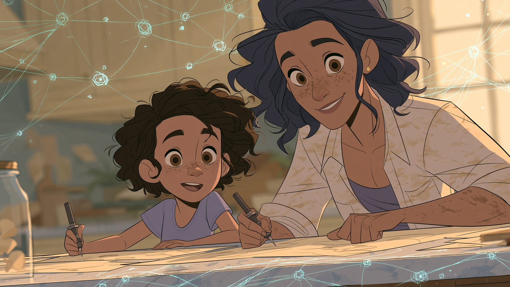

Zrozum AI, żeby mądrze towarzyszyć dziecku, gdy z niej korzysta. Wybrałem 7 lekcji przy takim założeniu, że nie musisz zostać ekspertem - wystarczy wiedzieć na tyle dużo, żeby rozmowa w domu była rozmową, a nie zakazem. Rytm: minimum kwadrans na jedno okienko w kalendarzu, najlepiej trzy takie okienka w tygodniu - jedna lekcja na okienko.

1. [Czym jest AI?](/podstawy/czym-jest-ai/) - pojęcia, których dziecko używa na co dzień, wyłożone tak, żebyście mówili tym samym językiem.
2. [Pierwsza rozmowa z AI](/podstawy/pierwsza-rozmowa-z-ai/) - załóż konto i zadaj kilka pytań samodzielnie. Trudno rozmawiać o narzędziu, którego się nie widziało od środka.
3. [Weryfikacja informacji](/podstawy/weryfikacja-informacji/) - model potrafi zmyślić datę, cytat albo źródło i brzmi przy tym zupełnie pewnie. Cztery kroki SIFT pokażesz dziecku przy pierwszym zadaniu domowym, w którym AI coś mu "podpowie".
4. [Mity vs rzeczywistość](/podstawy/mity-vs-rzeczywistosc/) - co z tego, co się o AI mówi, jest przesadą. Przydaje się i w rozmowie z dzieckiem, i przy własnych obawach.
5. [Nie dajmy się zwariować](/podstawy/nie-dajmy-sie-zwariowac/) - lekcja o podejściu do AI bez stresu i bez FOMO (lęku, że coś ważnego Cię omija). Napisana do dorosłego czytelnika, ale te same argumenty działają przy stole w kuchni.
6. [AI a dzieci](/etyka/ai-a-dzieci/) - na jednym narzędziu z domu odczytasz dzisiejszy próg wieku u dostawcy i spiszesz trzy rzeczy, których dziecko nie wkleja. Family Link, czyli kontrola rodzicielska Google, w Polsce nie włącza Gemini na koncie dziecka.
7. [Etyczne aspekty](/etyka/etyczne-aspekty/) - uprzedzenia modeli, odpowiedzialność za decyzję o osobie i zasada uczciwości: jeśli tekst powstał z pomocą AI, nie udajesz, że to wyłącznie Twoja praca. Tematy, które prędzej czy później wrócą przy odrabianiu lekcji.

Listę "czego nie wkleja dorosły" (klienci, PESEL, tajemnica firmy) zostawiam w lekcji [Prywatność i dane](/etyka/prywatnosc/) - to osobna lekcja, gdy AI wchodzi do Twojej pracy, nie do zeszytu dziecka.

:::note[Co dalej]
Przewodnik jest bezpłatny. Gdy skończysz tę ścieżkę, wróć do [programu kursu](/#program-kursu) albo [zobacz inne ścieżki](/sciezki/).
:::
